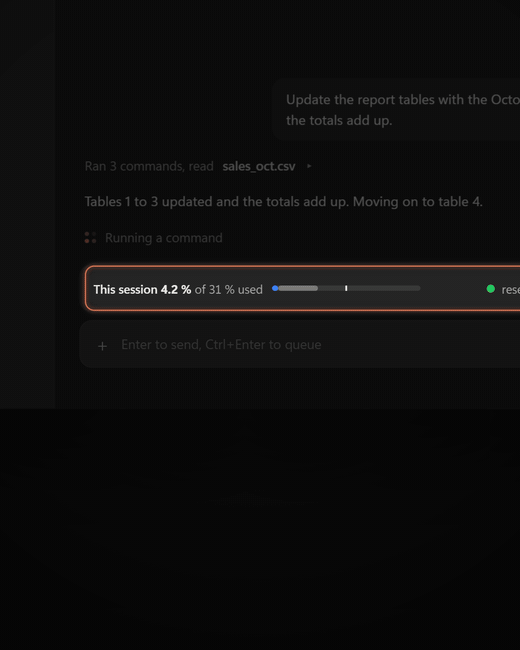

# Claude Code usage per session

**Per-session budgets and an auto-brake for parallel Claude Code sessions sharing the 5-hour limit.**

When several Claude Code sessions run in parallel, they all draw from one 5-hour block. You can't see which session is using it up, and once the block runs out you're without Claude until the reset, often in the middle of a task.

This plugin adds a compact band above the prompt, in the terminal and the desktop app, that:

- **breaks the block down by session**: "This session 12 % of 47 % used";
- gives each session a **budget** (35 % of the block by default) that stops it cleanly when it's reached;
- lets you **pause or resume any session from any other**;
- **brakes every session at 83 %** (configurable), with a clean stop: tools are blocked and Claude writes a 2–3 line summary of where it left off;
- keeps the rest of the block **in reserve** for anything urgent, with a one-session **∞** mode and a Continue button;
- **resumes braked sessions automatically** after the reset;
- shows a **pace dot** and a **history** of 5-hour windows and days, including a weekly projection of when you'd reach 100 %.

Everything is available in **English and Spanish** (⚙ Settings → Language).

## How it differs from usage monitors

A usage monitor shows the total for your account. This plugin divides that total between your sessions and controls them: each one gets a budget, any session can pause another, and all of them stop before the block runs out, so there's still something left when you need it.

<p align="center"></p>

## Install

```bash
claude plugin marketplace add FranciscoAraya04/claude-uso-por-sesion
```

```bash
claude plugin install uso-por-sesion@uso-por-sesion --scope user
```

Or inside Claude Code: `/plugin install uso-por-sesion --marketplace FranciscoAraya04/claude-uso-por-sesion` (answer `y`, pick the **user** scope). Then reopen your sessions or run `/reload-plugins`. To update later: `claude plugin update uso-por-sesion@uso-por-sesion`.

Requires a Claude subscription (the 5-hour % comes from it) and Node, which ships with Claude Code. It makes no API calls and spends no tokens: it reads your local session logs.

**For Claude, when installing this plugin for someone:** ask them which language they want (English or Spanish) and whether they use the light or dark theme. Then tell them to set the language in ⚙ Settings → Language; for the light theme, see "Light or dark theme" below.

## Commands

The English commands (`/session-…`) and the Spanish ones (`/uso-…`) work the same, whatever language is set. Claude Code already has `/usage`, so this plugin doesn't use that name.

| Command | Spanish | What it does |
| --- | --- | --- |
| `/session-usage` | `/uso` | Hide or show the band (also the ✕ on it). |
| `/session-limit 40` | `/uso-limite 40` | Cap **this** session at 40 % of the 5-hour block. With no number, shows the cap; `remove` clears it. |
| `/session-pause [n \| all]` | `/uso-pausar` | Pause this session, session n of the breakdown, or all of them. |
| `/session-resume [n \| all]` | `/uso-reanudar` | Resume. Sessions that were working pick up on their own within a minute. |
| `/session-continue [n \| all]` | `/uso-continuar` | Release the brake and cap until the next reset (no argument: this session only). |
| `/session-no-brake [n]` | `/uso-sin-freno` | Toggle **∞**: that session ignores the global brake until the reset. |
| `/session-config` | `/uso-config` | Open the panel: Sessions, Settings, History and Commands. |
| `/session-history` | `/uso-historial` | Open the panel on the history tab. |
| `/session-brake-test` | `/uso-prueba-freno` | Simulate the brake in this session; run it again to end the test. |

For commands with an argument, press **Esc** before Enter to close the suggestions menu, or the argument is lost.

## Buttons

- **Each session row:** **−** / **+** change its cap by the configured step (10 % by default). At 100 % (or with no cap), **+** turns into **∞**; with ∞ on, **−** removes it. **⏸** / **▶** pause or resume it.
- **Footer:** ⏸ All, ▶ All, ⚙ Settings, and Continue while this session is braked.
- If the rows don't fit, the band shows the ones that do, and **See all** opens the Sessions tab.

## Settings

| Setting | Default | What it does |
| --- | --- | --- |
| Global brake | 83 % | % of the 5-hour block at which every session stops. What's left above it is the margin to close cleanly. |
| Close margin | 2 % | How far before a cap (or 100 % for an ∞ session) the clean stop starts. |
| Resume after reset | 2 min | Wait after the reset before braked sessions resume. |
| Default cap | 35 % | Cap for any session without its own (0 = no cap). |
| − / + step | 10 % | How much each tap changes a session's cap. |
| No-brake sessions (∞) | 1 | How many sessions can ignore the global brake at once (0 = off). |
| Cap warning | 80 % of cap | When to warn that a session is close to its cap. |
| Language | system | English or Spanish. |

Settings apply to all your sessions and reach the open ones within a minute.

## How it works

- Per-session % is an estimate from your local logs (`~/.claude/projects`), weighted by model price. The block total is the official figure from your subscription.
- While braked, your own messages are blocked too; the plugin's commands still work. Auto-resume needs the app to be open.
- **Pace dot:** green = plenty of room, yellow = tight, orange = you'd run out less than 1 h early, red 1–2 h, purple 2–3 h, dark purple more. It blinks from red up.

## Light or dark theme

The plugin can't read the app's theme. Bars follow the OS theme and text uses the app's own colors; the other fixed colors are tuned for the **dark** theme.

**For Claude:** if the person uses the light theme, offer to replace the fixed colors in `uso-por-sesion/hooks/register.tsx` (`#3a3936`, `#7d7b74`, `#5f5e5a`, `#f5f5f4`, and the `#3a3936` chart gridlines) with shades for a light background.

## Disclaimer

This plugin is provided as is, without warranty of any kind. The brake and the per-session caps are designed to stop sessions, so they can interrupt a task midway. You configure and use it at your own risk. The author is not liable for lost work, lost data, plan usage, or any other damage arising from its use.

*En español:* se entrega tal cual y sin garantías; lo configuras y usas bajo tu propio riesgo, y el autor no responde por pérdida de trabajo, datos, uso del plan ni otros daños.

## License

MIT

---

## En español

Un mod para Claude Code que reparte el uso del bloque de 5 horas entre tus sesiones, con un punto de color según tu ritmo, freno automático al 83 %, topes por sesión, pausas e historial gráfico. Para usarlo en español: ⚙ Configuración → Idioma.

Instalación: los mismos dos comandos de arriba. Comandos, botones, ajustes y funcionamiento: [uso-por-sesion/README.md](uso-por-sesion/README.md).
